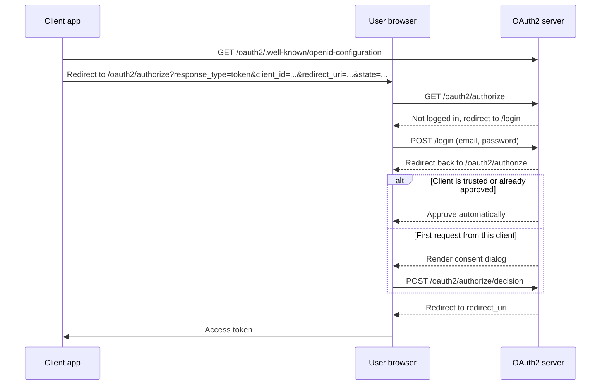

# OAuth2 Server

[](https://github.com/ptitsynamv/oauth2-server/actions/workflows/deploy.yml)
[](package.json)


A self-hosted OAuth 2.0 authorization server built on [Express](https://expressjs.com/), [oauth2orize](https://github.com/jaredhanson/oauth2orize) and [Passport](https://www.passportjs.org/), with MongoDB for persistence. It has server-rendered login, consent and registration pages, and an OpenID-style discovery document, so SPA clients such as [`angular-oauth2-oidc`](https://github.com/manfredsteyer/angular-oauth2-oidc) can configure themselves.

## Features

- **Four OAuth 2.0 grant types:** authorization code, implicit, resource owner password credentials, and client credentials.
- **Discovery endpoint** at `/oauth2/.well-known/openid-configuration`, so clients can configure themselves.
- **Consent screen with auto-approval:** clients marked `isTrusted`, or clients the user has already approved, skip the consent dialog.
- **Client authentication** at the token endpoint with HTTP Basic, credentials in the request body, or resource-owner password.
- **Bearer-protected resources:** `/userinfo` returns the user's ID and email; `/user-role` returns `admin` or `guest`.
- **Self-service registration pages** for users (passwords hashed with bcrypt) and OAuth clients.
- **Built-in test page** at `/test` that runs each grant type against the running server.
- **Continuous deployment** to a VPS with GitHub Actions, SFTP and pm2.

## Tech stack

| Layer | Technology |
| --- | --- |
| Runtime | Node.js (CommonJS, no build step) |
| Web framework | Express 4 |
| OAuth 2.0 | oauth2orize, Passport (`local`, `basic`, `oauth2-client-password`, `oauth2-resource-owner-password`, `bearer`) |
| Database | MongoDB with Mongoose 5 |
| Views | EJS |
| Process manager / proxy | pm2, Apache 2 |

## Prerequisites

| Tool | Version | Notes |
| --- | --- | --- |
| [Node.js](https://nodejs.org/) | **16.x recommended** | The lockfile (`lockfileVersion: 2`) and dependencies such as Mongoose 5.12 / MongoDB driver 3.6 date from the Node 14–16 era. Newer Node versions have not been tested with this project. |
| npm | 7+ | Comes with Node 16. |
| [MongoDB](https://www.mongodb.com/) | **4.x recommended** | The bundled MongoDB driver 3.6 officially supports servers up to 4.4. Newer servers have not been tested. |
| [nvm](https://github.com/nvm-sh/nvm) / [nvm-windows](https://github.com/coreybutler/nvm-windows) | any | Optional. Lets you switch to Node 16 without changing your system Node. |
| [Docker](https://www.docker.com/) | any | Optional. The easiest way to run a matching MongoDB locally. |

## Getting started

### 1. Clone and select the Node version

```bash
git clone https://github.com/ptitsynamv/oauth2-server.git
cd oauth2-server

nvm install 16
nvm use 16
```

### 2. Install dependencies

```bash
npm ci        # installs the exact versions from package-lock.json
```

### 3. Start MongoDB

If you don't already have a MongoDB instance running, start one with Docker:

```bash
docker run -d --name oauth2-mongo -p 27017:27017 mongo:4.4
```

### 4. Configure environment variables

Copy the template and fill it in:

```bash
cp .env.example .env
```

```dotenv
PORT=3000
MONGO_URL='mongodb://localhost:27017/oauth2-server'
DEPLOY_URL='http://localhost:3000/'
FRONTEND_OAUTH2_PROJECT_URL='http://localhost:3000/'
TOKEN_LIFE=3600
SECURITY_STATE=''
ADMIN_EMAIL='you@example.com'
```

| Variable | Purpose |
| --- | --- |
| `PORT` | Port the HTTP server listens on. |
| `MONGO_URL` | MongoDB connection string. |
| `DEPLOY_URL` | Public base URL of this server, used to build the discovery document. **Must end with `/`.** |
| `FRONTEND_OAUTH2_PROJECT_URL` | Base URL used for `redirect_uri` on the `/test` page. **Must end with `/`.** For local testing, set it to the same value as `DEPLOY_URL`. The code exchange sends `${DEPLOY_URL}test/authorization-code` as the redirect URI, and the exchange fails if that doesn't match the URI used at authorization. |
| `TOKEN_LIFE` | `expires_in` value (seconds) returned by the implicit grant. |
| `SECURITY_STATE` | `state` value returned by the implicit grant. |
| `ADMIN_EMAIL` | Email address that `/oauth2/user-role` reports as `admin`. |

### 5. Run the server

```bash
npm start         # development: nodemon, restarts on file changes
# or
npm run server    # plain node
```

The server starts on `http://localhost:3000/`.

### 6. Create a user and a client

1. Open `http://localhost:3000/register-user` and register a user.
2. Open `http://localhost:3000/register-client` and register a client. The `/test` page and the Angular sample expect:
   - **Client ID:** `antropogenez-client-id`
   - **Client secret:** `ssh-secret`
3. Open `http://localhost:3000/info` to check what is stored.

### 7. Try the grant flows

Open `http://localhost:3000/test` and choose a flow. The **Resource Owner Password Credentials** flow uses a username and password hardcoded in [routes/test.js](routes/test.js). Register that user, or edit the values locally.

> **Troubleshooting: `address already in use :::3000`**
> Find the process with `lsof -wni tcp:3000` (macOS/Linux) or `netstat -ano | findstr :3000` (Windows), then stop it with `kill -9 <pid>` or `taskkill /PID <pid> /F`.

## API endpoints

All OAuth endpoints are mounted under `/oauth2`.

| Method | Path | Auth | Description |
| --- | --- | --- | --- |
| `GET` | `/oauth2/.well-known/openid-configuration` | none | Discovery document. |
| `GET` | `/oauth2/.well-known/jwks` | none | JWKS. Currently returns an empty object. |
| `GET` | `/oauth2/authorize` | session (redirects to `/login`) | Authorization endpoint (`response_type=code` or `token`). |
| `POST` | `/oauth2/authorize/decision` | session | Submits the user's consent decision. |
| `POST` | `/oauth2/token` | client credentials | Token endpoint for the `authorization_code`, `password` and `client_credentials` grants. |
| `GET` | `/oauth2/userinfo` | Bearer token (user) | Returns `{ _id, email }`. |
| `GET` | `/oauth2/user-role` | Bearer token (user) | Returns `admin` or `guest`. |

Site pages: `/`, `/login`, `/logout`, `/account`, `/register-user`, `/register-client`, `/info`, `/test`.

### Authorization flow (implicit grant)



### Angular client example (`angular-oauth2-oidc`)

```ts
export const authConfig: AuthConfig = {
  issuer: 'http://localhost:3000/oauth2',
  clientId: 'antropogenez-client-id',
  redirectUri: window.location.origin,
  responseType: 'token',
  scope: 'api',
  oidc: false,
};
```

## Project structure

```text
oauth2-server/
├── index.js                     # App entry: Mongo connection, session, Passport, router mounting
├── auth/
│   └── index.js                 # Passport strategies (local, basic, client-password, resource-owner, bearer)
├── routes/
│   ├── index.js                 # Router barrel
│   ├── oauth2.js                # oauth2orize server: grants, exchanges, /oauth2/* endpoints
│   ├── site.js                  # Login, logout, account, registration, /info
│   └── test.js                  # /test page that runs each grant type
├── models/
│   ├── index.js                 # Model barrel: user, client, accessToken, authorizationCode
│   ├── User.js
│   ├── Client.js
│   ├── AccessToken.js
│   └── AuthorizationCode.js
├── public/views/                # EJS templates (login, consent dialog, registration, test pages)
│   └── includes/                # Shared header and footer partials
├── utilities/
│   └── index.js                 # getUid() token generator, JSON error helper
├── example.oauth2-server.conf   # Apache reverse-proxy virtual host template
├── .env.example                 # Environment variable template
└── .github/workflows/deploy.yml # CI/CD: SFTP upload and pm2 restart on push to master
```

## Deployment

### Continuous deployment

Every push to `master` runs [.github/workflows/deploy.yml](.github/workflows/deploy.yml), which:

1. Uploads the repository to `/var/projects/oauth2-server` over SFTP, excluding `.git`, `.env` and `node_modules`.
2. Runs `npm install` on the server and restarts the app with pm2.

Required repository secrets: `SFTP_IP`, `SFTP_USERNAME`, `SFTP_PASSWORD`, `SFTP_PORT`. The `.env` file must already exist on the server.

### Manual deployment with pm2

```bash
pm2 start index.js --name oauth2-server
pm2 logs
```

### Apache 2 reverse proxy

1. Copy [example.oauth2-server.conf](example.oauth2-server.conf) to `/etc/apache2/sites-available/oauth2-server.conf` and replace the host and port placeholders.
2. Enable the proxy modules:
   ```bash
   sudo a2enmod proxy proxy_http proxy_ajp proxy_balancer proxy_connect proxy_html rewrite
   ```
3. Disable the default site and enable this one:
   ```bash
   sudo a2dissite 000-default.conf
   sudo a2ensite oauth2-server.conf
   ```
4. Check the config and restart Apache:
   ```bash
   sudo apache2ctl configtest
   sudo systemctl restart apache2
   ```
5. If something fails, check the logs in `/var/log/apache2/error.log`.

## Known limitations

This project is a learning and demo server. Before using it with real users, address the following:

- The session secret is hardcoded, and sessions use the in-memory store.
- `redirect_uri` is not checked against a registered value for the client.
- `/info`, `/register-user` and `/register-client` do not require authentication, and `/info` shows client secrets.
- Tokens are opaque random strings generated with `Math.random()`. They are not JWTs, and they do not expire on the server.
- `/.well-known/jwks` is a stub, and `id_token` is not issued.
- The `request` package is deprecated.

## License

MIT. See the `license` field in [package.json](package.json).
